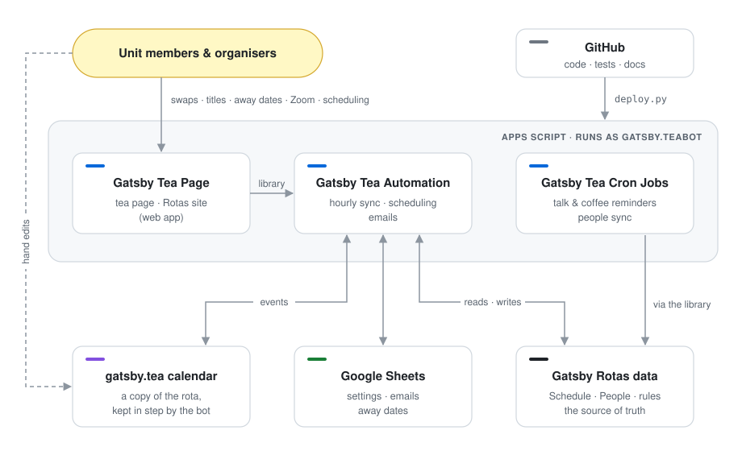

# gatsby-teabot

Automation for the Gatsby Unit tea / rota system: research and tea talks, tea, MLJC, TNJC (with CSNJC),
coffee cleaning and external seminars. It runs as Google Apps Script under the shared bot account
(the gatsby.teabot account), with no server of its own.

What to read where (each topic lives in one place only):
- **Unit members:** the Gatsby Rotas site (https://gatsbyunit.github.io/gatsby-teabot/rotas/): rules, guides,
  the schedule, and how to swap, add a title or set away dates. (It replaced the Gatsby Rotas pages and databases on Notion in 2026.)
- **Organisers and the tea tsar:** [docs/handbook.md](docs/handbook.md): how the parts fit together, scheduling,
  yearly jobs, handing over.
- **New organiser or tea tsar:** the handover guide at the end of the [handbook](docs/handbook.md#handing-over-a-guide-for-new-organisers-and-tea-tsars).
- **Whoever maintains the code:** this file.
- **Next steps:** [docs/next-steps.md](docs/next-steps.md): keeping this public repo clean, what else is public
  (tea-page links), and how the move off Notion went.

## The setup at a glance

The rota data (the Gatsby Rotas site) decides who does what and when; the calendar is a copy that the bot keeps in step, and hand edits to it are
copied back. The [handbook](docs/handbook.md) explains each part.

## Layout
- `apps-script/automation/`: "Gatsby Tea Automation", all the logic: calendar ↔ rota sync, scheduling and
  finalising, emails, organiser reminders, and everything behind the tea page and the Rotas site. The rota data
  (schedule, people, rota rules) lives in the bot's "Gatsby Rotas data" sheet (`Store.js`); the code reaches it
  through `notion_request` (`Notion.js`) in the shape of Notion's API, where it came from (moved off Notion on
  2026-11-11, see docs/next-steps.md). Settings are described at the top
  of `Config.js`, one-off admin functions in `Setup.js`.
- `site/`: the tea page itself, a static page on GitHub Pages (https://gatsbyunit.github.io/gatsby-teabot/),
  published by `.github/workflows/pages.yml` whenever it changes. It is not served by Apps Script because Apps
  Script web pages don't open for people signed in to several Google accounts. Its address is public, so without the
  personal code or the unit key (`PAGE_KEY`) in the link it only offers to email your link to your registered address.
- `site/rotas/`: the Gatsby Rotas site (https://gatsbyunit.github.io/gatsby-teabot/rotas/): the member guides and
  the rota views, served by `apps-script/automation/Site.js`. The guides live in the "Gatsby Rotas pages" sheet in
  the bot's Drive (one row per page; moved off Notion on 2026-10-31); the schedule, people and rota rules come
  from the rota data sheet. Every slot and person has an address (`?slot=<id>`, `?person=<id>`). Members sign in by picking their name and opening the link the bot emails
  them (valid for an hour); the browser then keeps the unit key and their tea-page token for six months (the tea
  page's own memory of them works too). Tsars edit the pages in place and slots, people and rota rules in small
  forms; rota changes are written straight into the rota data, and every edit is noted in the log sheet. People who
  are not on the rotas get in through the site access list (`Access.js`, "Site access" tab of the rota data sheet):
  readers, and unit admins, who also edit every rota's slots and people. Static files only, like the tea page;
  `edit.js` loads only for people signed in by name. The tea page's `?as=<person id>` is the tea tsar's read-only,
  red-framed debug view of someone's page (`api_debug_state`: no away dates, address half hidden, no swap codes). Developed against a local stand-in for `Site.js` that
  is not part of this repo.
- `apps-script/page/`: "Gatsby Tea Page", the tea page's back end (web app): `doPost` with thin `api_*` wrappers,
  and a `doGet` that points old links to the new address. It uses the automation as the library `TeaBot`,
  because a web page can call every top-level function of its own project; a test makes sure it exposes
  nothing else.
- `apps-script/cron-jobs/`: the older "Gatsby Tea Cron Jobs" (talk reminders, people sync, away-date sheets,
  adding newcomers to rotas), now under version control. They read and write the rota data through the
  automation (library `TeaBot`, `store_fetch`).
- `apps-script/archive-helper/`: one-off functions that moved everything superseded into the archive folder in
  the bot's Drive. It is the only project with access to all of the bot's Drive, so the live ones don't need it.
- `mcp/`: an MCP server for AI agents (`server.js`, no dependencies), so an agent reads the rotas and makes
  changes through the bot's web API instead of a browser. See "Agents" below.
- `deploy/`: `deploy.py` and `projects.json`.
- `tests/`: `node tests/run.js`, `node tests/mcp.js` (the MCP server against a stand-in for the bot), and `python3 tests/crosscheck_scheduler.py`, which runs the scheduler port
  against Kevin's original `script.py` on random inputs.

## Deploying
GitHub is the single source of truth for the four projects in `deploy/projects.json`. Every deployed file
starts with a header naming the commit and saying not to edit it in the Apps Script editor.

    python3 deploy/deploy.py --check   # is anything live different from GitHub?
    python3 deploy/deploy.py           # deploy what is on origin/main

The deploy refuses unless your checkout is clean and equal to origin/main, runs the tests, saves (to
`backups/drift/`) and shows anything that was edited live, uploads the complete project through the Apps Script
API, verifies it and moves the tea page to the new version. It uses the bot account's clasp login
(`clasp login --user teabot`, once). CI (GitHub Actions) only runs the tests; it never deploys.

Useful from the Apps Script editor:
- `send_examples()` in `Checks.js` emails the TNJC organiser one example of every bot email.
- `backup_all()` in `Backup.js` snapshots the calendar and the sheets (rota data included) into a new spreadsheet.

## Agents (MCP)
`mcp/server.js` lets an AI agent (Claude Code, Claude Desktop, …) use the tea bot the way a person uses the tea page
and the Rotas site. Everyone: read the schedule, people, rota rules and pages; see their own duties and who usually
does them; ask for, answer and withdraw swaps; set talk titles; cancel a talk; add and remove away dates; change
their photo (from a picture file; needs macOS or ImageMagick) and email; leave the tea system. Tsars and organisers
also: add, change and remove slots; change people and rota rules; edit pages; plan, fill and finalise a rota. It
acts as the person whose personal tea-page code it is given and may do exactly what they may do; the bot logs every
change under their name. Nothing to install (Node 18 or later), nothing to host:

    claude mcp add -s user gatsby-teabot -e TEABOT_TOKEN=<your code> -- node <path to this repo>/mcp/server.js

The code is the `t=…` part of your personal tea-page link ("Copy my code for an AI agent" at the bottom of your tea
page copies it). It works like a password; if it leaks, clear your cell in column D of the identity sheet and the
daily maintenance issues a new one. Admin steps in the Apps Script editor (permissions, one-off functions) are not
covered.

## Where the data lives
| What | Where |
|---|---|
| People, rota, schedule, titles, guest speakers | "Gatsby Rotas data" sheet in the bot's Drive (source of truth; edited on the Rotas site) |
| Registered emails, tea-page tokens | identity sheet (the Cron Jobs add a row per new person; the tea tsar fills in the email, people change it on their tea page) |
| Away dates | one sheet per person (`away_dates` folder), linked from their People row |
| Emails, IDs | constants sheet, first tab |
| Automation switches (dry run / pause, rotas) and dated reminders | constants sheet, tabs **Automation** and **Automation reminders** |
| Calendar | a copy of the rota data; hand edits are pulled back into it |

Secrets never go in this repo. The sheets and scripts it names are owned by the bot account and not shared by
link, so their IDs here give nobody access.

## Credits and licence
MIT licence (see `LICENSE`). The scheduling algorithm is a port of Kevin's
[KevHH/gatsby_tea_scheduling](https://github.com/KevHH/gatsby_tea_scheduling). The Cron Jobs and the scripts the
bot replaced come from earlier tea tsars.
