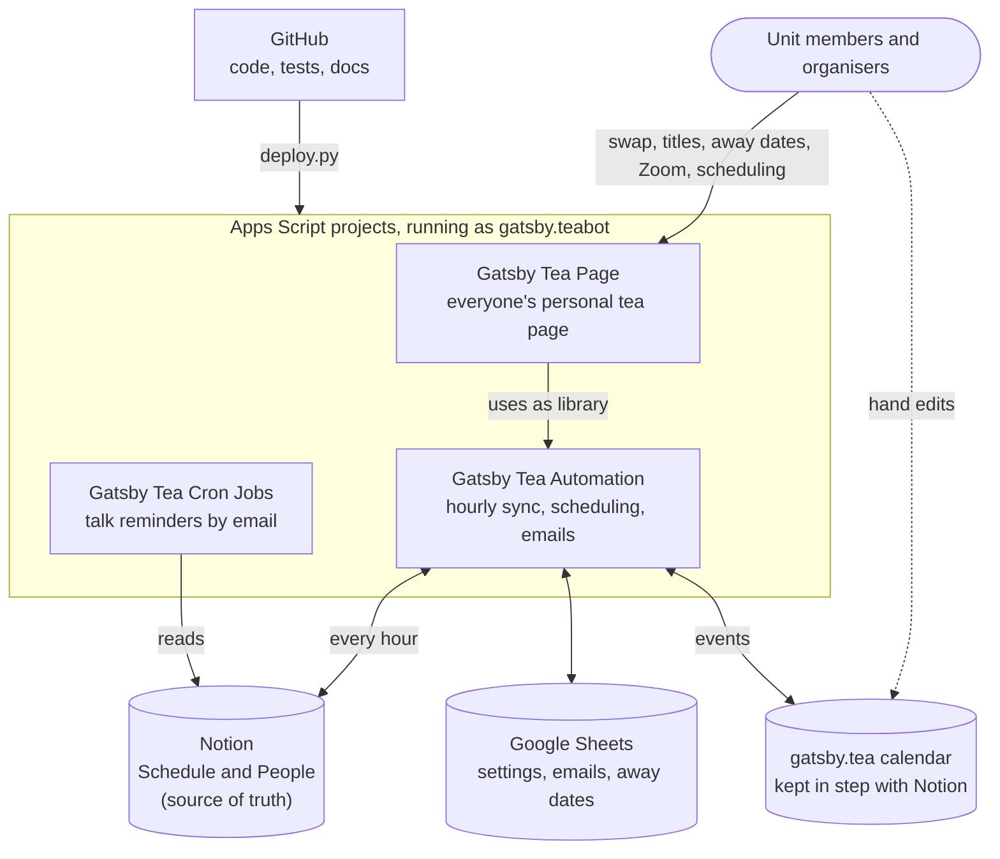

# gatsby-teabot

Automation for the Gatsby Unit tea / rota system: research and tea talks, tea, MLJC, TNJC (with CSNJC),
coffee cleaning and external seminars. It runs as Google Apps Script under the shared bot account
(gatsby.teabot@gmail.com), with no server of its own.

What to read where (each topic lives in one place only):
- **Unit members:** the Gatsby Rotas pages on Notion (gcnu.notion.site): rules, guides, and how to swap, add a
  title, set away dates or request Zoom.
- **Organisers and the tea tsar:** [docs/handbook.md](docs/handbook.md): how the parts fit together, scheduling,
  yearly jobs, handing over.
- **Whoever maintains the code:** this file.
- **Next steps:** [docs/next-steps.md](docs/next-steps.md): keeping this public repo clean, what else is public
  (personal data on the Notion site, tea-page links), and how one might move off Notion.

## The setup at a glance

Notion decides who does what and when; the calendar is a copy that the bot keeps in step, and hand edits to it are
copied back. The [handbook](docs/handbook.md) explains each part.

## Layout
- `apps-script/automation/`: "Gatsby Tea Automation", all the logic: calendar ↔ Notion sync, scheduling and
  finalising, emails, organiser reminders, and everything behind the tea page. Settings are described at the top
  of `Config.js`, one-off admin functions in `Setup.js`.
- `apps-script/page/`: "Gatsby Tea Page", the personal tea page (web app): `doGet`, thin `api_*` wrappers and
  `Page.html`. It uses the automation as the library `TeaBot`, because a web page can call every top-level
  function of its own project; a test makes sure it exposes nothing else.
- `apps-script/cron-jobs/`: the older "Gatsby Tea Cron Jobs" (talk reminders, people sync, away-date sheets,
  adding newcomers to rotas), now under version control.
- `apps-script/archive-helper/`: one-off functions that moved everything superseded into the archive folder in
  the bot's Drive. It is the only project with access to all of the bot's Drive, so the live ones don't need it.
- `deploy/`: `deploy.py` and `projects.json`.
- `tests/`: `node tests/run.js`, and `python3 tests/crosscheck_scheduler.py`, which runs the scheduler port
  against Kevin's original `script.py` on random inputs.

## Deploying
GitHub is the single source of truth for the four projects in `deploy/projects.json`. Every deployed file
starts with a header naming the commit and saying not to edit it in the Apps Script editor.

    python3 deploy/deploy.py --check   # is anything live different from GitHub?
    python3 deploy/deploy.py           # deploy what is on origin/main

The deploy refuses unless your checkout is clean and equal to origin/main, runs the tests, saves (to
`backups/drift/`) and shows anything that was edited live, uploads the complete project through the Apps Script
API, verifies it and moves the tea page to the new version. It uses the bot account's clasp login
(`clasp login --user teabot`, once). CI (GitHub Actions) only runs the tests; it never deploys.

Useful from the Apps Script editor:
- `send_examples()` in `Checks.js` emails the TNJC organiser one example of every bot email.
- `backup_all()` in `Backup.js` snapshots the calendar, Notion and the sheets into a new spreadsheet.

## Where the data lives
| What | Where |
|---|---|
| People, rota, schedule, titles, guest speakers | Notion (source of truth) |
| Registered emails, tea-page tokens, away calendars | identity sheet (emails synced from Notion by the Cron Jobs) |
| Away dates | one sheet per person, linked from their Notion page |
| Emails, IDs, Notion token | constants sheet, first tab |
| Automation switches (dry run / pause, rotas) and dated reminders | constants sheet, tabs **Automation** and **Automation reminders** |
| Calendar | a copy of Notion; hand edits are pulled back into Notion |

Secrets never go in this repo. The sheets and scripts it names are owned by the bot account and not shared by
link, so their IDs here give nobody access.

## Credits and licence
MIT licence (see `LICENSE`). The scheduling algorithm is a port of Kevin's
[KevHH/gatsby_tea_scheduling](https://github.com/KevHH/gatsby_tea_scheduling). The Cron Jobs and the scripts the
bot replaced come from earlier tea tsars.
